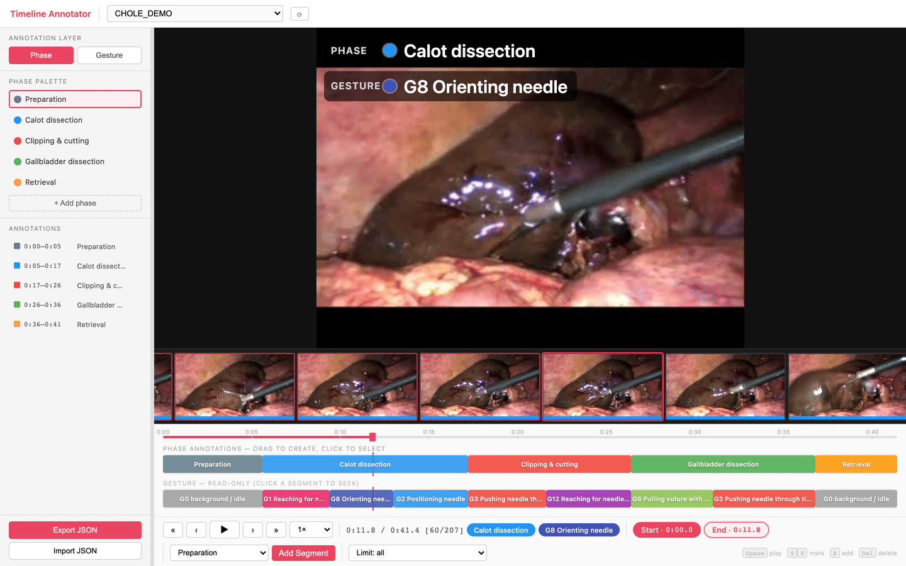
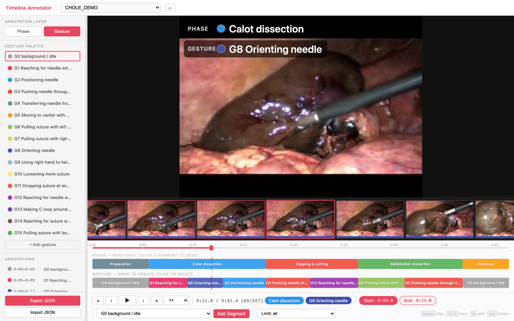

# Timeline Annotator

**日本語** | [English](README.md)

手術動画の時間区間を **Phase（大まかな作業段階）** と **Gesture（JIGSAWS 準拠の
細分化）** の 2 レイヤでラベリングするブラウザツール。Vite の開発サーバと、標準
ライブラリのみの Python スクリプト数本で動く。バックエンドも DB もモデルもなく、
ファイルシステムがそのままストア（フレームは `outputs/frames/`、ラベルは
`outputs/annotations/`）。

`endo_3d_verbalization` の Three.js ビューア内にあったアノテータを単体リポジトリ
として切り出したもの。**ラベル語彙はそのまま**、動画とアノテーション結果は
引き継いでいない。

> **動画はローカルから出ません。** このツールはローカルで動く開発サーバのみで
> 完結し、外部への送信は一切ない。動画・フレーム・アノテーションはすべて自分の
> マシン上に残る。



Phase レイヤ。編集対象が Phase レーンで、Gesture は下に読み取り専用で並ぶ。
Gesture レイヤに切り替えると両者が入れ替わり、パレットに JIGSAWS の語彙が入る:



<sub>スクリーンショットは下記の CC BY サンプル動画を使用。区間の切り方は UI を
示すための例示であり、臨床的なアノテーションではない。クレジットは
[docs/images/CREDITS.md](docs/images/CREDITS.md)。</sub>

---

## 必要なもの

| | 用途 |
|---|---|
| Node.js 18+ | 開発サーバ（`npm install` は初回のみ） |
| Python 3.10+ | フレーム準備スクリプト（pip 依存なし） |
| ffmpeg / ffprobe | 動画のデコードと画像サイズ取得 |

`ffmpeg` は動画から切り出す場合に必要。フレーム画像がすでにある場合は
`index_frames.py` だけを使えばよく、`ffprobe` は画像サイズの取得に使われる。

---

## サンプル動画で試す

データセットの申請は不要。オープンアクセス症例報告の補足資料として公開された
腹腔鏡下胆嚢手術の動画で、**CC BY 2.0**（帰属表示のみで自由に利用可）。
上のスクリーンショットと同じ素材。

```bash
git clone https://github.com/TaiToTo/surgical-timeline-annotator.git
cd surgical-timeline-annotator

curl -L -o data/videos/LapChole_sample.ogv \
  "https://upload.wikimedia.org/wikipedia/commons/6/67/A-gallbladder-torsion-presenting-as-acute-cholecystitis-in-an-elderly-woman-A-case-report-1752-1947-5-588-S1.ogv"

python scripts/extract_frames.py --fps 5     # 41秒 → 207 フレーム
python scripts/check_sequences.py            # → ok  LapChole_sample
npm install && npm run dev                   # → http://localhost:5180
```

プルダウンで `LapChole_sample` を選び、Phase レーンをドラッグすれば始められる。

出典: Boer J, Boerma D, de Vries Reilingh T, *J Med Case Reports* 2011, 5:588,
[Wikimedia Commons](https://commons.wikimedia.org/wiki/File:A-gallbladder-torsion-presenting-as-acute-cholecystitis-in-an-elderly-woman-A-case-report-1752-1947-5-588-S1.ogv)
経由（[CC BY 2.0](https://creativecommons.org/licenses/by/2.0/)）。

---

## 自分の素材を使う

```bash
# 1. 動画を置く
cp /path/to/case01.mp4 data/videos/

# 2. フレームを切り出す（--fps がアノテーションの時間分解能）
python scripts/extract_frames.py --fps 5

# 3. 準備できたか確認（FAIL が出たら先に進まない）
python scripts/check_sequences.py

# 4. 起動
npm install        # 初回のみ
npm run dev        # → http://localhost:5180
```

ヘッダのプルダウンからフレームシーケンスを選ぶとアノテーションを開始できる。

**フレーム画像がすでに手元にある場合**は 2. の代わりに:

```bash
python scripts/index_frames.py /path/to/images --name CASE01 --fps 5
```

元ディレクトリは変更せず、`outputs/frames/CASE01/` にシンボリックリンクを張る
（`--copy` でコピー）。詳細は [docs/frame_preparation.md](docs/frame_preparation.md)。

---

## どういう動画を想定しているか

ffmpeg がデコードできる動画なら何でもよい。このツールは画素を一切見ず、
フレーム列とフレームレートだけを必要とするので、内視鏡映像でも、コンソールの
録画でも、術野を撮った外部カメラでも、ドライラボの訓練課題でも構わない。

指定が要るのは **1 フレームの構成**だけ（[docs/frame_preparation.md](docs/frame_preparation.md)）。

| レイアウト | 中身 | 典型的な素材 |
|---|---|---|
| `single` | 1 視点が画面全体 | 内視鏡・腹腔鏡の録画 |
| `duo` | 左右 2 分割（左 = コンソール、右 = 術野） | コンソール録画と室内カメラを左右に合成したもの |
| `grid` | 2×2（左上 = コンソール、右上 = 術野、左下 = 手元、右下は未使用） | 多カメラの訓練用リグ |

### 対象になりうる公開データセット

いずれも**直接ダウンロードはできない**。申請フォームまたはデータ利用同意が要り、
学術利用限定。条件は各データセットの規約を必ず確認すること。

| データセット | 素材 | 既存アノテーション |
|---|---|---|
| [JIGSAWS](https://cirl.lcsr.jhu.edu/research/hmm/datasets/jigsaws_release/) | da Vinci のドライラボ課題（縫合・結紮・針渡し）。ステレオ内視鏡映像＋キネマティクス | **本ツール同梱の 15 ジェスチャそのもの**、技能スコア |
| [Cholec80](https://camma.unistra.fr/datasets/) | 腹腔鏡下胆嚢摘出術 80 例、25 fps | 7 phase、器具の有無（CC BY-NC-SA 4.0） |
| [CholecT50](https://github.com/CAMMA-public/cholect50) | 胆嚢摘出術 50 例 | `<器具, 動作, 対象>` の三つ組、phase |
| [MultiBypass140](https://github.com/CAMMA-public/MultiBypass140) | 胃バイパス術 140 例、多施設 | phase、step、術中有害事象 |
| [Endoscapes](https://github.com/CAMMA-public/Endoscapes) | 腹腔鏡映像 201 例 | Critical View of Safety、セグメンテーション、検出 |

最も相性が良いのは JIGSAWS で、Gesture レイヤの語彙は**まさにその 15 ジェスチャ**。
それ以外は Phase パレットを自分で用意することになる。

### 同梱の Phase パレットについて

Gesture は JIGSAWS なのでそのまま使えるが、**Phase パレットはそのままでは使えない**。
このツールが元々対象にしていたドライラボ課題のもので、`default` は色つき
ステーションを巡る課題、`suturing` は針を通す面と向きを表している。胆嚢摘出術を
「Blue」「Red」でラベリングしても意味がないので、まず [src/labels.js](src/labels.js)
の `PHASE_SETS` を書き換えること。→ [docs/label_sets.md](docs/label_sets.md)

---

## 使い方の要点

- **区間の作成**: レーンの空き部分をドラッグ、または `S` / `E` でマーク → `A`
  （Add Segment）。パレットで選択中のラベルが割り当たる。
- **ラベル変更**: セグメントをクリックしてポップオーバーから選ぶか、サイドバーの
  パレット項目をセグメントへドラッグ＆ドロップ。
- **レイヤ切替**: サイドバー上部の Phase / Gesture。非アクティブ側は下段の読み取り
  専用レーンに出る（未保存の編集は保持される）。
- **Export JSON**: `outputs/annotations/<seq>_annotations_<timestamp>.json` に保存。
  Gesture レイヤは `_gesture` 付きの別ファイル。シーケンスを選び直すと最新の
  Phase / Gesture ファイルが自動で読み込まれる。
- ショートカット: `Space` 再生、`S`/`E` マーク、`A` 追加、`Del` 削除、
  `←`/`→` 1 フレーム（`Shift` で 5 秒）、`Cmd/Ctrl+Z` undo。

UI とデータモデルの詳細は [docs/annotator_spec.md](docs/annotator_spec.md)。

---

## ラベル語彙を変える

Phase パレットと Gesture 一覧は [src/labels.js](src/labels.js) の 1 ファイルに
まとまっている。編集すればページのリロードだけで反映される（ビルド不要）。
どのシーケンスがどの Phase セットで開くかは `PHASE_SET_RULES` で決まる。
→ [docs/label_sets.md](docs/label_sets.md)

---

## テスト

```bash
npm test        # vitest（src/**/*.test.js）
```

対象は純粋ロジック（`src/labels.js`）のみ。

---

## 注意

- **公開デモはない。** アプリはフレーム配信と保存を開発サーバの API に依存して
  いるため、静的ホスティングだけでは動かない。ローカルで `npm run dev` する。
- `outputs/frames/` と `data/videos/` は `.gitignore` 済み。`outputs/annotations/`
  は**意図的に追跡対象**（エクスポートした JSON がこのリポジトリの成果物のため）。
  自分の症例データを公開フォークで扱う場合はここを確認すること。

---

## ライセンス / 出自

[MIT](LICENSE)。`endo_3d_verbalization` リポジトリの viewer/annotator から派生。
AI コーディングアシスタント向けの作業ルールは [AGENTS.md](AGENTS.md)
（`CLAUDE.md` はそのシンボリックリンク）。
