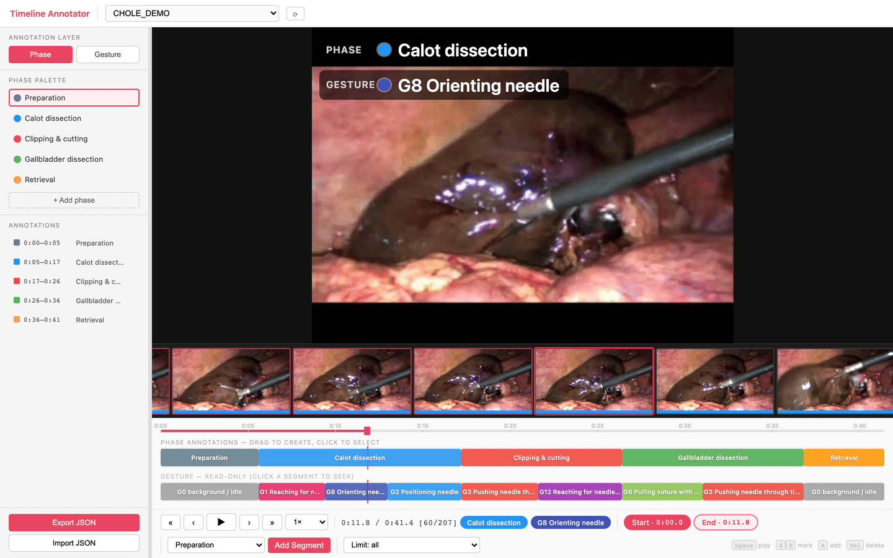
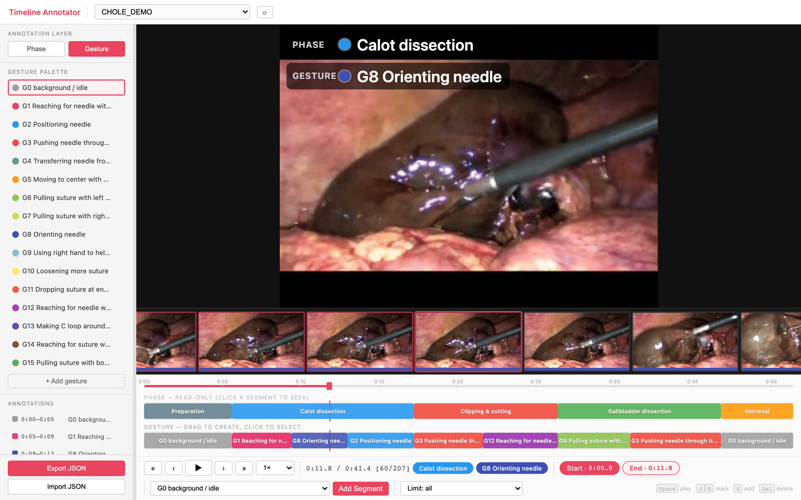

# Timeline Annotator

[](https://github.com/TaiToTo/surgical-timeline-annotator/actions/workflows/ci.yml)
[](LICENSE)

**English** | [日本語](README.ja.md)

A browser tool for labelling time regions of a surgical video on two layers:
**Phase** (coarse task stages) and **Gesture** (JIGSAWS-style sub-segmentation).
It is a Vite dev server plus a handful of stdlib-only Python scripts — no
backend, no database, no model. The filesystem is the store: frames under
`outputs/frames/`, exported labels under `outputs/annotations/`.

Extracted from the `endo_3d_verbalization` research workbench, where the same
annotator lived inside a larger Three.js viewer. The label vocabularies came
across unchanged; the video material and the annotations did not.

> **Your video never leaves your machine.** Everything runs against a local dev
> server and nothing is uploaded anywhere. Videos, frames and annotations all
> stay on disk.



Phase layer: the editable lane is Phase, the Gesture track sits below it
read-only. Switching to the Gesture layer swaps the two and loads the JIGSAWS
vocabulary into the palette:



<sub>Screenshots use the CC BY sample clip linked below; the segment boundaries
are illustrative, not a clinical annotation. Full credit in
[docs/images/CREDITS.md](docs/images/CREDITS.md).</sub>

---

## Requirements

| | Used for |
|---|---|
| Node.js 18+ | The dev server (`npm install` on first run only) |
| Python 3.10+ | Frame preparation scripts (no pip dependencies) |
| ffmpeg / ffprobe | Decoding video and reading image dimensions |

`ffmpeg` is only needed when extracting from video. If you already have frame
images, `index_frames.py` is enough, and `ffprobe` is used to read their size.

---

## Try it on a sample video

No dataset request needed. This clip is a laparoscopic gallbladder operation
published as supplementary material to an open-access case report, and it is
**CC BY 2.0** — free to download and use with attribution. It is the same clip
in the screenshots above.

```bash
git clone https://github.com/TaiToTo/surgical-timeline-annotator.git
cd surgical-timeline-annotator

curl -L -o data/videos/LapChole_sample.ogv \
  "https://upload.wikimedia.org/wikipedia/commons/6/67/A-gallbladder-torsion-presenting-as-acute-cholecystitis-in-an-elderly-woman-A-case-report-1752-1947-5-588-S1.ogv"

python scripts/extract_frames.py --fps 5     # 41 s clip -> 207 frames
python scripts/check_sequences.py            # -> ok  LapChole_sample
npm install && npm run dev                   # -> http://localhost:5180
```

Pick `LapChole_sample` from the dropdown and start dragging on the Phase lane.

Source: Boer J, Boerma D, de Vries Reilingh T, *J Med Case Reports* 2011, 5:588,
via [Wikimedia Commons](https://commons.wikimedia.org/wiki/File:A-gallbladder-torsion-presenting-as-acute-cholecystitis-in-an-elderly-woman-A-case-report-1752-1947-5-588-S1.ogv)
([CC BY 2.0](https://creativecommons.org/licenses/by/2.0/)).

---

## Using your own material

```bash
# 1. Drop a video in
cp /path/to/case01.mp4 data/videos/

# 2. Extract frames (--fps sets the annotation time resolution)
python scripts/extract_frames.py --fps 5

# 3. Verify the sequence is loadable — do not continue past a FAIL
python scripts/check_sequences.py

# 4. Start it
npm install        # first run only
npm run dev        # → http://localhost:5180
```

Pick a frame sequence from the dropdown in the header to start annotating.
Each entry shows the segment counts of its newest saved files
(`phase N · gesture M`), so labelled sequences stand out from unlabelled ones.

**If you already have frame images**, replace step 2 with:

```bash
python scripts/index_frames.py /path/to/images --name CASE01 --fps 5
```

This leaves your source directory untouched and symlinks it into
`outputs/frames/CASE01/` (`--copy` to copy instead). See
[docs/frame_preparation.md](docs/frame_preparation.md).

---

## What kind of video does it expect?

Any video ffmpeg can decode. The tool never looks at pixels — it only needs a
directory of frames and a known frame rate — so the material can be endoscopic,
a console recording, an external camera on the operating field, or a dry-lab
training task.

What you do have to declare is how one frame is composed. Pass `--layout`
([docs/frame_preparation.md](docs/frame_preparation.md)):

| Layout | Contents | Typical source |
|---|---|---|
| `single` | One camera view filling the frame | Endoscopic/laparoscopic recording |
| `duo` | Two views side by side (left = console, right = body) | Console capture + a room camera, muxed side by side |
| `grid` | 2×2 (top-left = console, top-right = body, bottom-left = hands; bottom-right ignored) | Multi-camera training rig |

### Public datasets that fit

None of these are direct downloads — each needs a request form or a data
agreement, and they are academic-use only. Check each dataset's own terms.

| Dataset | Material | Existing annotations |
|---|---|---|
| [JIGSAWS](https://cirl.lcsr.jhu.edu/research/hmm/datasets/jigsaws_release/) | da Vinci dry-lab tasks — suturing, knot-tying, needle-passing; stereo endoscopic video plus kinematics | The **15 surgical gestures this tool ships with**, plus skill scores |
| [Cholec80](https://camma.unistra.fr/datasets/) | 80 laparoscopic cholecystectomy videos at 25 fps | 7 surgical phases, tool presence (CC BY-NC-SA 4.0) |
| [CholecT50](https://github.com/CAMMA-public/cholect50) | 50 cholecystectomy videos | `<instrument, verb, target>` action triplets, phases |
| [MultiBypass140](https://github.com/CAMMA-public/MultiBypass140) | 140 gastric bypass videos, multicentric | Phases, steps, adverse events |
| [Endoscapes](https://github.com/CAMMA-public/Endoscapes) | 201 laparoscopic videos | Critical View of Safety, segmentation, detection |

JIGSAWS is the closest match: the Gesture layer here **is** its 15-gesture
vocabulary. Everything else needs a Phase palette of your own.

### About the shipped Phase palettes

The Gesture set is JIGSAWS and transfers directly. The **Phase palettes do
not** — they came from the dry-lab tasks this tool was built for
(`default` is a colour-station relay task, `suturing` labels the plane and
direction of each needle pass). Annotating a cholecystectomy with "Blue" and
"Red" is not what you want; edit `PHASE_SETS` in [src/labels.js](src/labels.js)
first. See [docs/label_sets.md](docs/label_sets.md).

---

## Using the annotator

- **Create a segment**: drag across an empty part of a lane, or mark with
  `S` / `E` and press `A` (Add Segment). The label currently selected in the
  palette is assigned.
- **Change a label**: click a segment and pick from the popover, or drag a
  palette entry from the sidebar onto the segment.
- **Switch layers**: Phase / Gesture at the top of the sidebar. The inactive
  layer shows in a read-only lane below (unsaved edits are preserved).
- **Export JSON**: saved to
  `outputs/annotations/<seq>_annotations_<timestamp>.json`. The Gesture layer
  goes to a separate file suffixed `_gesture`. Reselecting a sequence
  auto-loads the newest Phase / Gesture files.
- **Shortcuts**: `Space` play, `S`/`E` mark, `A` add, `Del` delete,
  `←`/`→` one frame (`Shift` for 5 s), `Cmd/Ctrl+Z` undo.

For the UI and data model in detail, see
[docs/annotator_spec.md](docs/annotator_spec.md).

---

## Changing the label vocabulary

The Phase palettes and the Gesture list live in a single file,
[src/labels.js](src/labels.js). Edit it and reload the page — there is no build
step. Which sequence opens with which Phase set is decided by
`PHASE_SET_RULES`. See [docs/label_sets.md](docs/label_sets.md).

---

## Tests

```bash
npm test        # vitest (src/**/*.test.js)
```

Coverage is limited to pure logic (`src/labels.js` today).

---

## Notes

- **There is no hosted demo.** The app depends on the dev server's API for
  listing sequences, serving frames and saving annotations, so static hosting
  alone will not work. Run `npm run dev` locally.
- `outputs/frames/` and `data/videos/` are gitignored. `outputs/annotations/` is
  **intentionally tracked**, since the exported JSON is this repo's deliverable.
  Check that this is what you want before committing case data to a public fork.

---

## Contributing

Issues and pull requests are welcome. Two house rules worth knowing before you
start:

- **No new runtime dependencies.** The page ships no npm dependencies (vite and
  vitest are dev-only) and the scripts are stdlib + `ffmpeg`/`ffprobe`.
- **`meta.json` is the contract** between the preparation scripts and the app.
  Change its shape in [scripts/frameseq.py](scripts/frameseq.py) and in
  `loadFrameSequence` ([src/annotator.js](src/annotator.js)) together, and update
  [docs/frame_preparation.md](docs/frame_preparation.md) in the same change.

The full working rules — including the setup flow for new material — are in
[AGENTS.md](AGENTS.md) (`CLAUDE.md` is a symlink to it).

---

## License

[MIT](LICENSE). Derived from the viewer/annotator in the
`endo_3d_verbalization` repository.
